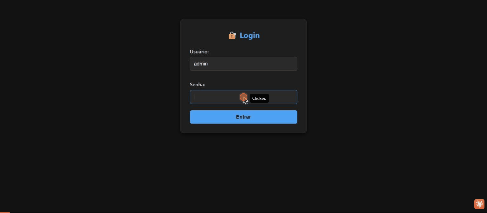

# Sistema de Login em PHP com `$_SESSION`

Projeto da disciplina **Linguagem e Técnicas de Programação** (Prof. José Carlos Flores) — Aula 9, com as atividades propostas no material (`readme.md` original) implementadas.

## Demonstração

Teste completo rodando no XAMPP local (login admin, painel, perfil administrativo, login de usuário comum, acesso negado ao perfil, login inválido):



## Estrutura

```
sistema-login/
├── login.html     → Formulário de login
├── valida.php     → Valida login, define nível de acesso e inicia sessão
├── painel.php     → Página protegida, mostra dados da sessão
├── perfil.php     → Página restrita a administradores
├── logout.php     → Encerra a sessão
└── css/
    └── estilo.css → Tema escuro (dark theme)
```

## Atividades implementadas

1. **Tema escuro no CSS** — `css/estilo.css` foi reescrito com paleta escura (fundo `#121212`, cartões `#1e1e1e`, texto claro, destaques em azul `#4ea1f3`).
2. **Nível de acesso na sessão** — `valida.php` agora reconhece dois usuários simulados, cada um com um nível:
   - `admin` / `12345` → nível `administrador`
   - `aluno` / `senha123` → nível `usuario`
   O nível é salvo em `$_SESSION['nivel']` e o `painel.php` exibe uma mensagem diferente para cada caso.
3. **Página `perfil.php` restrita ao admin** — verifica `$_SESSION['nivel']`; se não for `administrador`, mostra "Acesso negado" em vez do conteúdo.
4. **Data do login na sessão** — `valida.php` grava `$_SESSION['login_em'] = date('d/m/Y H:i:s')` no momento do login, e o `painel.php` exibe essa data.

## Como testar

1. Copie a pasta `sistema-login` para `C:\xampp\htdocs\sistema-login\`
2. Inicie o Apache no XAMPP
3. Acesse `http://localhost/sistema-login/login.html`
4. Teste com:
   - **Admin:** usuário `admin`, senha `12345` → acesso total, inclui link para `perfil.php`
   - **Usuário comum:** usuário `aluno`, senha `senha123` → sem acesso a `perfil.php`

## Passo a passo do que foi feito para rodar no XAMPP

1. **Copiar o projeto para o XAMPP** — os arquivos (`login.html`, `valida.php`, `painel.php`, `perfil.php`, `logout.php`, `css/estilo.css`) foram colocados em `C:\xampp\htdocs\sistema-login\`.
2. **Resolver conflito de porta** — ao tentar iniciar o Apache pelo XAMPP Control Panel, apareceu o erro *"Port 80 in use"*. A porta 80 estava ocupada pelo **IIS do Windows** (serviço `W3SVC`), que já estava rodando na máquina.
   - Em vez de desligar o IIS (que pode ser usado por outra coisa no PC), a porta do Apache foi trocada de **80 para 8080** no arquivo `C:\xampp\apache\conf\httpd.conf`:
     ```
     Listen 8080
     ServerName localhost:8080
     ```
3. **Iniciar o Apache** — com a porta livre, o módulo **Apache** foi iniciado normalmente pelo XAMPP Control Panel (botão **Start**).
4. **Acessar o sistema** — como o Apache ficou na porta 8080, o acesso local passou a ser:
   ```
   http://localhost:8080/sistema-login/login.html
   ```
   (se o Apache estiver na porta 80 padrão em outra máquina, basta usar `http://localhost/sistema-login/login.html`, como no enunciado original)
5. **Testes realizados** (veja o GIF acima):
   - Login válido como `admin` → painel mostra nível "administrador", data/hora do login e link para a página de perfil.
   - Acesso à página `perfil.php` como admin → conteúdo liberado.
   - Logout do admin.
   - Login válido como `aluno` → painel mostra nível "usuario", **sem** o link de perfil.
   - Acesso direto a `perfil.php` como aluno → tela de "Acesso negado".
   - Login com usuário/senha incorretos → tela de erro "Login inválido!".

Também foi testado localmente com o servidor embutido do PHP (`php -S`), cobrindo: login válido (admin e aluno), login inválido, acesso a página protegida sem sessão, acesso negado ao perfil para não-administrador e logout — todos os cenários se comportaram como esperado antes mesmo de subir no XAMPP.
